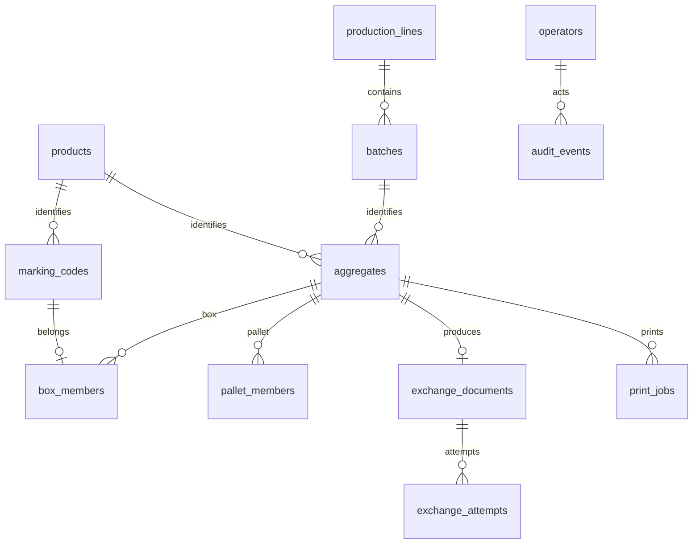

# Архитектура демо АРМ

Версия 0.2. Один общий стол обслуживает две линии розлива. Существующие GPS Track & Trace, MySQL поставщика и оборудование линии не используются и не изменяются.

## Компоненты

Сенсорный клиент HTML/CSS/JavaScript обращается по HTTP API к FastAPI. Сервер исполняет правила `domain.py` и хранит данные через `repository.py` в PostgreSQL. На компьютере разработчика всё запущено локально. На заводе сервер и PostgreSQL следует размещать на отдельном компьютере, моноблок использовать как клиент. Интерфейс не содержит внешних шрифтов, CDN, npm-зависимостей и тяжёлых графических библиотек.

Планируемый адаптер камеры должен передавать фактически прочитанные коды, сохраняя служебные символы. Сейчас адаптер заменён генератором кодов DEMO. Чтение изображения и проверка физической читаемости не реализованы. Печать автоматически получает отдельное задание при закрытии агрегата; в демо открывается текстовая этикетка через браузер. Физический принтер и подтверждение печати не подключены.

## Модель данных

Дополнительно: `station` хранит контекст единственного рабочего места и версию состояния; `packing_recipes` и `station_settings` — рецепты; `draft_codes` и `draft_pallet_boxes` — незавершённые составы; `command_receipts` — обработанные команды. `sandbox_submissions` отдельно фиксирует реальные попытки отправки в тестовый True API. Демо-документы и ответы имитатора не смешиваются с ними.

Вместо одного JSON сохранены нормализованные строки, внешние ключи, уникальные ограничения и проверки. Уникальность кода в `box_members` запрещает два короба для одной бутылки; уникальность `box_id` в `pallet_members` запрещает две паллеты для одного короба. Триггеры проверяют типы упаковок и принадлежность незавершённым составам. В демо закрытые упаковки не удаляются и не разбираются.

## Транзакции и повторные запросы

Каждая команда блокирует одну строку `station` через `FOR UPDATE`, сверяет `revision` и сохраняет изменения одним коммитом. Закрытие упаковки, состав, документ обмена, задание печати и событие создаются атомарно. Ошибка бизнес-правил оставляет состав прежним и сохраняет событие отказа.

Клиент передаёт UUID запроса. Повтор с тем же UUID и телом не исполняется заново. Повтор UUID с другой операцией блокируется. Устаревшая версия состояния возвращает HTTP 409 с текущими данными: оператор видит конфликт и повторяет действие осознанно.

Подключения чтения используют REPEATABLE READ. Изменение рецептов запрещено при незавершённой упаковке. Линию и партию нельзя менять во время сборки. Паллета в демо состоит из коробов одной линии, партии и продукции; это выбранное ограничение демо, которое надо согласовать в окончательном ТЗ.

## Интеграции

`integrations/true_api.py` поддерживает только фиксированный HTTPS-хост sandbox ЦРПТ, авторизацию присоединённой CMS-подписью, запрос сведений о КИ, транспорт отправки документа с откреплённой подписью и чтение результата. Конкретные пути методов, тип документа, товарная группа и JSON-схема должны быть проверены по документации участника. Создание производственных КИГУ/КИТУ/SSCC не реализовано.

Подписанные байты документа передаются без повторной сериализации. До сетевого вызова намерение отправки сохраняется в `sandbox_submissions`. При тайм-ауте результат остаётся неопределённым; повтор того же документа блокируется. Получение HTTP 200 или внешнего ID не трактуется как итоговое принятие. Ответы имитатора не меняют реальные статусы ГИС МТ.

## Эксплуатация и границы

По умолчанию приложение и PostgreSQL слушают только loopback. Для сетевого демо задаются общий логин/пароль рабочего места и HTTPS через обратный прокси. Это не промышленная ролевая модель: действия записываются от `demo-operator`. Для эксплуатации нужны персональные учётные записи, роли, управление сертификатами и соответствующая настройка ОС.

Демо загружает реестр в память для построения интерфейса. При промышленном объёме за три года нужны серверная пагинация, отдельные запросы поиска, индексы по реальной нагрузке, политика архивирования и обслуживание журналов. Текущие тесты не подтверждают SLA 99%, производительность реальной камеры, круглосуточную работу или восстановление при всех аппаратных сбоях.

## Неопределённости нового ТЗ

1. Тип короба: групповая или транспортная упаковка, источник идентификаторов и формат этикеток.
2. Противоречие между запретом базы поставщика и её упоминанием как источника. Демо не обращается к ней.
3. Последовательное чтение коробов при укладке или чтение всей паллеты камерой. Демо фиксирует конкретные идентификаторы каждого короба.
4. Частота, состав и лимиты запросов True API; доступность партии и сведений о нанесении. Опрос каждую секунду не заложен как гарантированная возможность ГИС МТ.
5. Неполные упаковки, смешанные партии, разборка и исправления после принятия ГИС МТ. Демо допускает изменение незавершённого состава; корректировки закрытых агрегатов требуют отдельного сценария.
